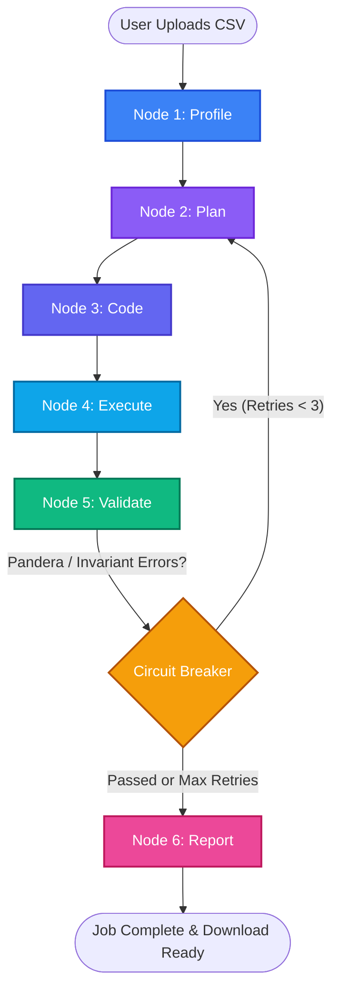

<div align="center">
  
  
  
  
  
</div>

<h1 align="center">Agentic Data Preprocessing System</h1>

<p align="center">
  <i>Multi-agent system that autonomously profiles, plans, codes, executes, and validates tabular datasets using a 5-stage LangGraph loop, Pandera lazy contracts, self-healing circuit breaker, and Great Expectations export.</i>
</p>

---

## 🌐 System Repositories

This project is decoupled into clean, independently deployable backend and frontend repositories:

- **Backend Repository** (This Repo): [Agentic-Data-Preprocessing-System](https://github.com/mkathir0/Agentic-Data-Preprocessing-System.)
  - FastAPI asynchronous service, 5-stage LangGraph state machine, Pandera validation engine, SQLite/PostgreSQL persistence.
- **Frontend Repository**: [Agentic-Data-Preprocessing-System-Frontend](https://github.com/mkathir0/Agentic-Data-Preprocessing-System-Frontend)
  - Next.js 16 + React 19 dashboard, real-time pipeline visualizer, 4D Quality Scorecard, and Great Expectations suite exporter.

---

## Data integrity policy

Each upload and its artifacts are stored under a unique job ID. Source files are never cleaned in place. CSV/TSV loading preserves identifier strings, literal text such as `NA` and `NULL`, and blank records; ambiguous numeric representations remain text.

Automatic transformations include whitespace trimming, whole-row exact deduplication, consistently parseable currency/numeric normalization, unambiguous date-format normalization, recognized boolean-token normalization, and case-only category normalization. The planner proposes format repairs from deterministic profiler evidence; the same policy is used by execution and integrity validation. Missing values are not imputed, fuzzy aliases are not merged, and arithmetic/temporal contradictions or outliers remain flagged for review unless an explicit domain rule is supplied.

At execution time, every nontrivial planned repair is checked again against deterministic evidence computed from the original upload. A planner cannot force a repair by naming an allowed action: unsupported parameters, ambiguous date order, email/value correction, reused-key reconciliation, or any repair without a matching candidate is preserved and reported for review. This protects against a model proposing an action that the profiler did not establish as safe.

Validation uses the original input schema and compares every output record and its multiplicity against the deterministic plan. Unplanned changes, missing columns, invented records, or unauthorized deletions fail integrity verification. Only a current run with both integrity and validation passing receives `COMPLETED`. Preserved candidates requiring review use `FAILED` with `current_step=REVIEW_FLAGGED` for compatibility with the existing API. Outputs that fail integrity are not available through the download endpoint.

Unverified outputs, legacy job records, and the old benchmark artifacts were removed. Raw source uploads remain intact, including `raw_sample.csv` and `massive_messy_dataset.csv`. New outputs are created per job and are not production-approved unless the current integrity and validation gates pass.

Generated scripts run with OS restrictions: macOS uses Seatbelt (`sandbox-exec`), and Linux uses a network-disabled, read-only-root Docker container with resource limits. Execution fails closed if the platform sandbox is unavailable. Each job starts from a fresh input copy and publishes output atomically after the sandbox exits.

Uploads are committed to a database-backed queue before the API responds. Run the API and worker as separate processes from the same project directory, with the same `DATABASE_URL`, `UPLOAD_DIR`, and `OUTPUT_DIR`:

```bash
# Terminal 1: API
uv run uvicorn app.main:app --reload --port 8000

# Terminal 2: durable queue worker
uv run python -m app.worker
```

Queue leases are renewed during processing and expire after worker loss, allowing another worker to reclaim interrupted jobs. Production replicas must share a durable database and the same upload/output filesystem. On Linux, build the executor image with `docker build -f Dockerfile.executor -t data-engineer-executor:latest .`; the worker needs access to the Docker daemon. On macOS, `sandbox-exec` is used directly.

Run the regression suite with:

```bash
.venv/bin/python -m unittest discover -s tests -v
```

## 🚀 Key Features

- **5-Stage LangGraph State Machine**: Cyclic feedback loop (`Profile` → `Plan` → `Code` → `Execute` → `Validate`) with state rollback and self-healing routing.
- **Pandera Schema Contracts**: In-memory `DataFrameSchema(lazy=True)` validation scanning all columns in a single vectorized pass and collecting complete violation cases.
- **Bounded Repair Loop**: Sends execution and validation findings back through planning and code generation for up to 3 retries. Unresolved or ambiguous findings are marked for human review; retry counts do not imply a successful repair.
- **4-Dimensional Data Quality Scoring**: Objective 0–100 quality scoring across **Completeness**, **Validity**, **Uniqueness**, and **Consistency**.
- **Data Integrity & Escalation Engine**: Exact duplicate detection, fuzzy near-duplicate *candidates* for review, and primary key collision detection. Fuzzy matches are never merged automatically.
- **Great Expectations (GX) Interoperability**: Automatic translation of validated Pandera contracts into standard Great Expectations JSON expectation suites for CI/CD and dbt pipelines.
- **API Protections**: API-Key authentication (`X-API-Key`), configurable CORS origins, HTTP security headers, and OS-restricted generated-code execution.

---

## 🧠 Architecture



### The 5 Graph Stages:
1. **Profile**: Fast deterministic profiling (inferred types, null ratios, cardinality, value ranges, potential primary keys).
2. **Plan**: LLM formulates a structured `TransformationPlan` with explicit column-level actions and domain assumptions.
3. **Code**: LLM writes idiomatic pandas cleaning code, receiving error stack traces on self-healing retries.
4. **Execute**: Runs the cleaning code in the platform OS sandbox against a fresh input copy, then publishes the verified candidate atomically.
5. **Validate**: Pandera schema verification, 4D scoring, cross-field checks, fuzzy candidate detection, key-conflict detection, and record-level integrity comparison.
6. **Report**: Writes an engineering Markdown report, a machine-readable validation JSON report, and a Great Expectations JSON suite when a contract is available. The cleaning script is stored separately; a cleaned CSV is only downloadable after record integrity passes.

---

## 📊 Benchmark Results

Earlier benchmark scores are withdrawn. They were produced by hand-written transformations that bypassed the current safety policy and are not evidence of production-ready output. `benchmark.py` now evaluates only the allowlisted cleaning policy, runs integrity and validation checks, and keeps benchmark candidates temporary. It does not claim LLM recovery or production approval.

The `massive_messy_dataset.csv` acceptance contract is recorded in [`tests/fixtures/massive_messy_dataset_expectations.json`](tests/fixtures/massive_messy_dataset_expectations.json). Its integration test asserts the exact 350-row duplicate removal, safe format repairs, record-level integrity, detection of unresolved injected defects, and the expected human-review outcome. The fixture is test input, not a source of rules for arbitrary datasets.

---

## 🛠️ Setup & Installation

### 1. Prerequisites
- Python 3.11+
- `uv` Package Manager

### 2. Environment Variables
Create a `.env` file in the root directory:
```ini
DATABASE_URL="sqlite:///./data_engineer.db"
UPLOAD_DIR="uploads"
OUTPUT_DIR="outputs"
API_KEY="default_secret_key"
LLM_MODEL="groq/llama-3.3-70b-versatile"
GROQ_API_KEY="your_groq_api_key_here"
ALLOWED_ORIGINS='["http://localhost:3000", "http://localhost:5173"]'
```

### 3. Run FastAPI Backend
```bash
# Sync dependencies
uv sync

# Run backend service
uv run uvicorn app.main:app --reload --port 8000
```

### 4. Run Unit Verification Tests
```bash
uv run python -m unittest discover -s tests -v
```

### 5. Run Benchmark Suite
```bash
uv run python benchmark.py
```

---

## 📡 API Endpoints

All endpoints require the `X-API-Key: <your_secret_api_key>` header.

| Method | Endpoint | Description |
|---|---|---|
| `POST` | `/api/jobs/upload` | Upload one or multiple raw CSV files to start autonomous processing. |
| `GET`  | `/api/jobs/` | List all historical preprocessing jobs. |
| `GET`  | `/api/jobs/{id}` | Real-time status, active node, and progress percentage. |
| `GET`  | `/api/jobs/{id}/insights` | Structured 4D Quality scores, Pandera verification, and GX suite data. |
| `GET`  | `/api/jobs/{id}/download` | Download the finalized, cleaned CSV. |
| `GET`  | `/api/jobs/{id}/report` | Download the generated Markdown quality report. |

---

<p align="center">
  <i>Built for autonomous, verifiable agentic data engineering.</i>
</p>
